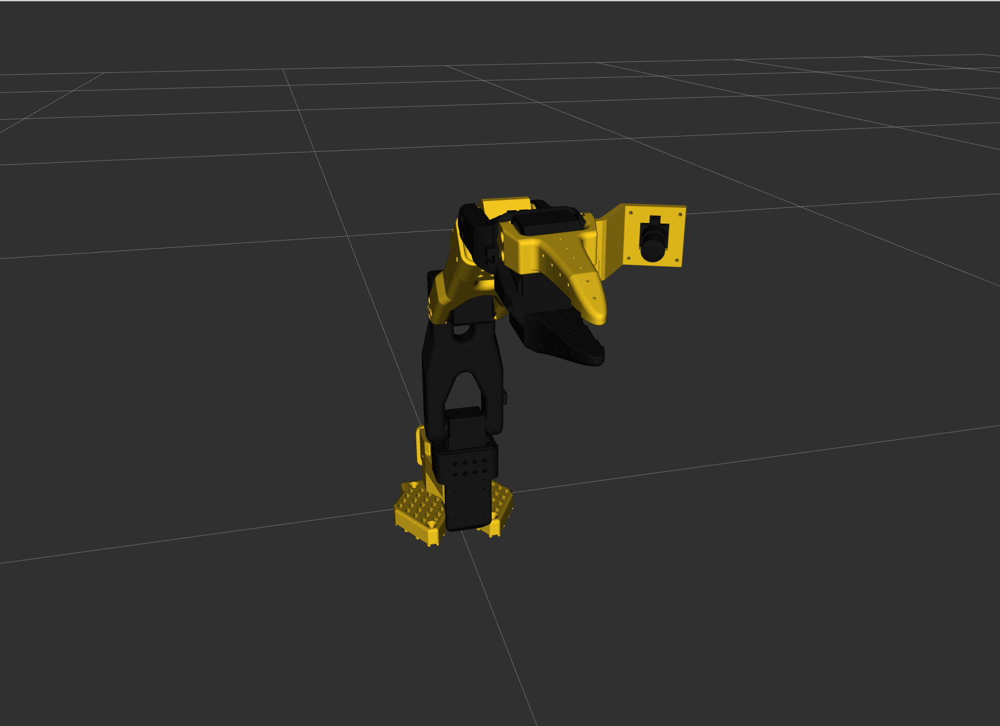

# so101_manipulation_stack

ROS 2 software stack for the **SO-101** 5-DOF arm: see an object on a table, pick it up, and place it.

> **Status:** M1 complete. Latest release: `v0.1-sim`. Next: M2 (C++ driver on the real arm).

| Component | Status |
|---|---|
| Package skeletons, CI, Docker | ✅ `v0.0-skeleton` |
| Robot description (URDF/xacro, `hw:=mock\|gz\|real`) | ✅ `v0.1-sim` · real-arm zero/direction check pending |
| Mock backend (`ros2_control`) + launch test in CI | ✅ `v0.1-sim` |
| Gazebo backend | ⏳ deferred |
| Real hardware driver | ⏳ M2 |

## Goals

1. **Hardware interface:** a C++ `ros2_control` driver for the STS3215 servo bus, with measured loop rate and latency.
2. **Mock, sim and real:** the same controllers run on mock hardware, Gazebo Harmonic and the real arm.
3. **Inverse kinematics:** a closed-form 5-DOF IK solver as a MoveIt 2 plugin, benchmarked against KDL.
4. **Camera calibration:** intrinsics and hand-eye calibration, with error reported in mm.
5. **Pick and place:** RGB detection to a top-down grasp planned with MoveIt, evaluated over 50+ trials.
6. **Engineering workflow:** gtest and pytest, Docker, and GitHub Actions CI.

## Hardware and environment

| Item | Details |
|---|---|
| Arm | SO-101 follower (5-DOF + gripper), Feetech STS3215 servos |
| Cameras | Wrist camera + external RGB webcam |
| OS / ROS | Ubuntu 24.04, ROS 2 Jazzy |
| Simulation | Gazebo Harmonic (`gz_ros2_control`) |
| Planning | MoveIt 2 |

## Packages

| Package | Build type | Purpose |
|---|---|---|
| `so101_description` | ament_cmake | URDF / xacro and meshes |
| `so101_hardware` | ament_cmake | `ros2_control` hardware interface (C++) |
| `so101_ik` | ament_cmake | Closed-form IK as a MoveIt kinematics plugin (C++) |
| `so101_bringup` | ament_cmake | Launch files and shared configuration |
| `so101_calibration` | ament_python | Camera intrinsics and hand-eye calibration tooling |
| `so101_perception` | ament_python | Object detection and back-projection |

`so101_moveit_config` will be generated with the MoveIt Setup Assistant in M3.

## Acknowledgements

The robot description and meshes are derived from TheRobotStudio's
[SO-ARM100](https://github.com/TheRobotStudio/SO-ARM100)
(`Simulation/SO101`, commit
[`5f6d2b8`](https://github.com/TheRobotStudio/SO-ARM100/tree/5f6d2b876a53a4872e405b991dd925556c9e38a4/Simulation/SO101)),
used under the
[Apache-2.0 license](https://github.com/TheRobotStudio/SO-ARM100/blob/5f6d2b876a53a4872e405b991dd925556c9e38a4/LICENSE).

## License

Apache-2.0. See [LICENSE](LICENSE).
